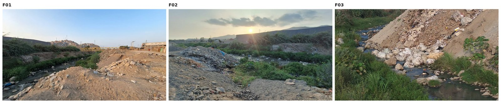
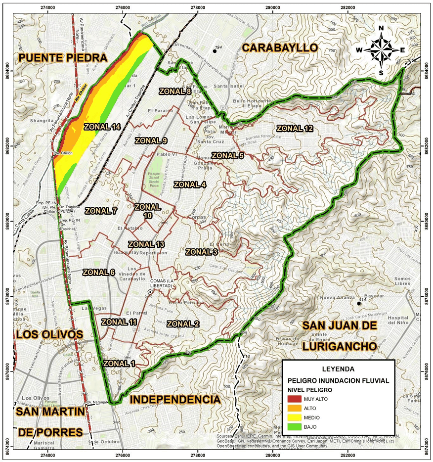
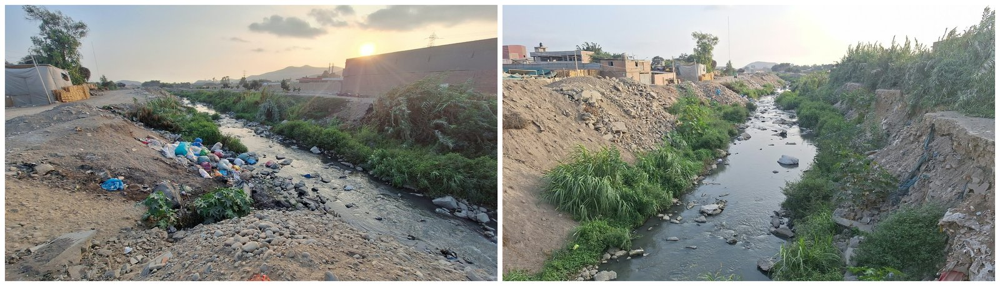
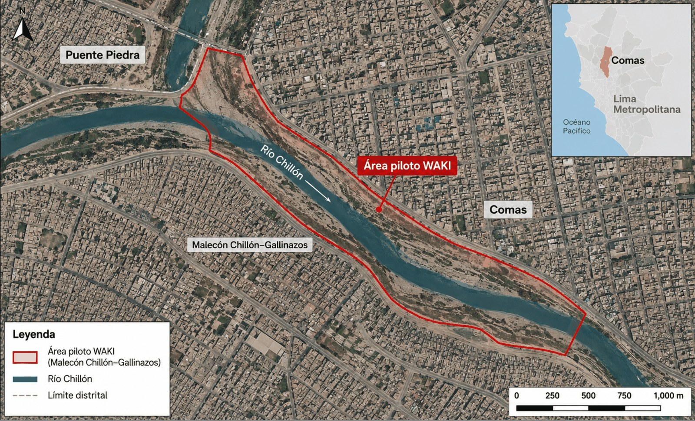

# 1. Empatizar: comprender el sistema y a las personas

[← Anterior](README.md) | [Índice](README.md) | [Siguiente →](02-definir.md)

## Perfiles y selección intencional

| Perfil | Diversidad buscada | Meta orientativa |
|---|---|---|
| Personal institucional | Personal que recibe reportes, verifica incidencias, realiza inspecciones de campo o prioriza intervenciones. | 2–3 participantes, si hay acceso |

## Preparación: antes, durante y después

| Antes | Durante | Después |
|---|---|---|
| Objetivo, permisos y logística; guías A/B; lugar seguro; grabación optativa; dos investigadores. | Consentimiento primero; preguntas abiertas; caso pasado concreto; escuchar; registrar citas sin identificar. | Completar ficha el mismo día, eliminar datos no necesarios, organizar citas y contradicciones. |

## Observación contextual segura (OBS-01)

| Campo | Registro del equipo |
|---|---|
| Lugar general / tramo autorizado | Malecón Chillón–Gallinazos, Comas (Zonal 14). Observación desde el malecón. La observación desde el tramo no requiere autorización al ser vía pública. |
| Fecha / observadores | 2026-10-31, 15:00–18:00 (UTC−05:00, hora de Perú), aproximadamente. Observador: 1 integrante del equipo. |
| Qué puede observarse desde espacio seguro | Ver detalle abajo. |
| Qué NO pudo observarse / limitaciones | Ver detalle abajo. |
| Fotografía o fuente permitida (ID) | [OBS-01-F01](#obs-01-f01), [OBS-01-F02](#obs-01-f02), [OBS-01-F03](#obs-01-f03) |
| Consentimiento / permiso correspondiente | Fotografías propias del equipo, tomadas desde la vía pública. |

### Qué puede observarse desde espacio seguro

Se observó en una de las márgenes acumulación de desmonte sin cobertura vegetal que llegaba hasta el borde del cauce, con sacos y residuos sólidos que invadían y reducían su sección ([OBS-01-F03](#obs-01-f03)). La margen opuesta presentaba vegetación alta en la parte superior, con el talud de tierra expuesto ([OBS-01-F01](#obs-01-f01)). En el cauce se apreciaron vegetación herbácea, residuos y zonas de agua estancada de coloración verdosa, con olor a desagüe ([OBS-01-F02](#obs-01-f02)).

Estas condiciones coinciden con las descritas en el Plan de Contingencia de la MDC (colmatación, desmonte y residuos) y con lo señalado en entrevista sobre riberas de desmonte susceptibles a erosión (MUN-01/Q04).

### Qué NO pudo observarse / limitaciones

- No se midió caudal ni nivel, por falta de instrumentos; solo hubo observación visual.
- No se ingresó al cauce ni a márgenes inestables, por seguridad.
- Fue una sola visita en temporada seca, así que no permite comparar cambios en el tiempo ni ver el río en crecida.
- Hubo un solo observador.
- No se recorrió todo el tramo: el observador percibió inseguridad ciudadana en la zona aledaña.
- No se conversó con vecinos durante la visita.

### Fotografías

Fotografías tomadas durante la observación OBS-01. Haz clic en cada ID para verla a tamaño completo.

| ID | Descripción | Archivo |
|---|---|---|
| OBS-01-F01 | Margen con vegetación alta en la parte superior y talud de tierra expuesto. | [obs-01-f01.jpg](anexos/img/empatizar/obs-01-f01.jpg) |
| OBS-01-F02 | Cauce con vegetación herbácea, residuos y agua estancada de coloración verdosa. | [obs-01-f02.jpg](anexos/img/empatizar/obs-01-f02.jpg) |
| OBS-01-F03 | Margen con desmonte sin cobertura vegetal hasta el borde del cauce, con sacos y residuos sólidos. | [obs-01-f03.jpg](anexos/img/empatizar/obs-01-f03.jpg) |

## Contexto del área de estudio

Material que ubica y caracteriza el tramo observado.

### ANX-01: Mapa de peligro por inundación fluvial del distrito de Comas

*Fuente: Plan de Prevención y Reducción del Riesgo de Desastres del distrito de Comas 2024–2030, Municipalidad Distrital de Comas.*

### ANX-02: Evidencia fotográfica del tramo piloto

Condiciones observadas en el tramo piloto del río Chillón, fotografías tomadas el 2026-10-31.

### CTX-01: Área piloto WAKI (Malecón Chillón–Gallinazos)

Delimitación del área piloto de WAKI en el Malecón Chillón–Gallinazos.

## Códigos de evidencia

Los códigos usados en este documento (MUN-01, MUN-02, OBS-01, Qn) se describen en [evidencias.md](evidencias.md). Las preguntas (Qn) corresponden a la [guía de entrevista](anexos/guia-entrevista.md).
