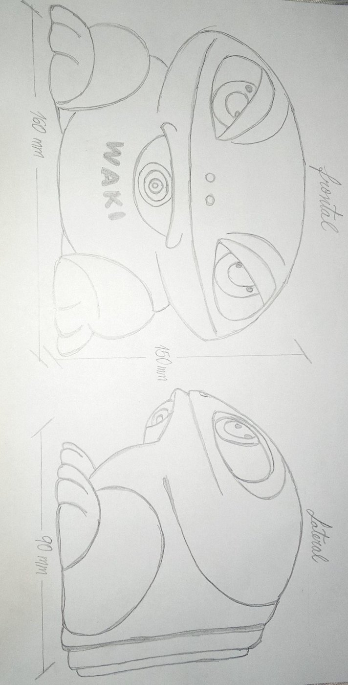
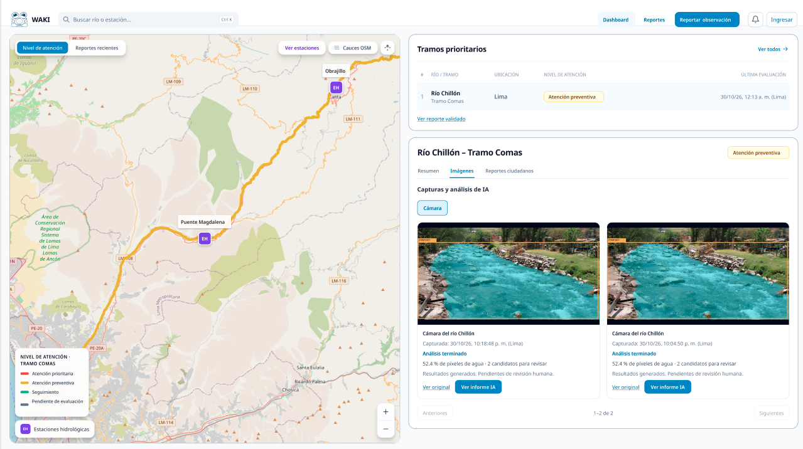

# 3. Idear: alternativas antes de elegir tecnología

[← Anterior](02-definir.md) | [Índice](README.md) | [Siguiente →](04-prototipar.md)

## Brainstorming

| Ideas | Descripción |
|---|---|
| Idea 1 | Sistema de cámaras de bajo costo para obtener fotografías periódicas de tramos ribereños y observar sus condiciones. |
| Idea 2 | Sistema de registro de reportes ciudadanos en una plataforma digital con un mapa para visualizar y localizar las incidencias. |
| Idea 3 | Sistema de criterios de atención preliminar para identificar y priorizar los tramos ribereños que requieren evaluación técnica preventiva. |

## Matriz de priorización (NOW–WOW–HOW)

| Cuadrante | Criterio de clasificación | Ideas evaluadas |
|---|---|---|
| **Now** | Alta factibilidad; valor claro; familiar para usuarios. | Registro de reportes ciudadanos georreferenciados; mapa digital de incidencias; visualización de información hidrometeorológica disponible en fuentes oficiales. |
| **Wow** | Alto valor y atractivo; implementación realizable en el MVP. | Sistema de cámaras de bajo costo para capturar imágenes periódicas; plataforma que integre imágenes, reportes ciudadanos y datos hidrometeorológicos; criterios de priorización preliminar de tramos ribereños. |
| **How** | Interesante pero aún incierta por costo, permiso, datos o seguridad. | Ampliar la red de cámaras; automatizar la detección de cambios en las imágenes; incorporar nuevos sensores locales; desarrollar modelos con mayor precisión. |
| **Descartar / Posponer** | Sin evidencia de necesidad o riesgo no controlable. | Emitir alertas oficiales de inundación; confirmar automáticamente un desborde mediante una fotografía; realizar predicciones autónomas sin modelos hidrológicos validados. |

## Mapa de concepto

| Campo | Descripción |
|---|---|
| Nombre | WAKI: Sistema inteligente y colaborativo para la observación preventiva de tramos ribereños ante el incremento del riesgo de inundaciones |
| Descripción | Sistema que integra fotografías captadas mediante cámaras de bajo costo, reportes ciudadanos georreferenciados e información hidrometeorológica oficial disponible. Mediante una plataforma web, la información se organiza y se aplican criterios preliminares de priorización para identificar los tramos que requieren evaluación técnica preventiva. |
| Público objetivo | Actores involucrados en la Gestión del Riesgo de Desastres y/o atención de emergencias; población local. |
| Beneficios | Centraliza información dispersa, facilita la ubicación de incidencias, permite consultar evidencias visuales y ayuda a organizar la atención preventiva de los tramos ribereños. |
| Actores involucrados | Equipo desarrollador de WAKI, personal municipal de GRD, serenazgo, población local, SENAMHI y ANA, según sus competencias y la disponibilidad de información. |
| Boceto | Pantallas: ver [Bocetos](#bocetos) (FIG-01 y ANX-04). Boceto conceptual inicial: ANX-03. |

### Bocetos

#### ANX-03: Boceto conceptual inicial

#### Pantallas

FIG-01: interfaz de la plataforma WAKI, dashboard e imágenes captadas por el dispositivo IoT (Figura 1 de la Ficha Técnica).

ANX-04: visualización de resultados del análisis de visión computacional en la plataforma. Ver [Prototipar](04-prototipar.md#anx-04-visualización-de-resultados-del-análisis-de-visión-computacional).

## Propuesta de valor

| Elemento | Respuesta |
|---|---|
| Insight | La identificación y priorización de tramos ribereños que requieren atención preventiva no depende únicamente de disponer de información sobre las condiciones del río, sino de integrar y verificar oportunamente datos hidrológicos oficiales, reportes ciudadanos y observaciones visuales, considerando las limitaciones de monitoreo y verificación en campo. |
| Nombre de la solución | WAKI: Sistema inteligente y colaborativo para la observación preventiva de tramos ribereños ante el incremento del riesgo de inundaciones |

### Canvas de la propuesta de valor: perfil del usuario

| Elemento | Contenido |
|---|---|
| Hace y necesita | Consultar información de las condiciones del río, revisar reportes ciudadanos, localizar incidencias, contrastar fotografías y datos oficiales, y priorizar tramos que requieren evaluación técnica preventiva. |
| Dolores | Información distribuida entre distintas fuentes; limitaciones para verificar incidencias en campo; recursos operativos limitados; posibles reportes falsos o incompletos; falta de información localizada sobre algunos tramos. |
| Beneficios | Consultar información integrada; localizar evidencias; comparar fotografías y reportes; distinguir incidencias pendientes de verificación; organizar la priorización de evaluaciones preventivas. |

### Canvas de la propuesta de valor: mapa de valor

| Elemento | Contenido |
|---|---|
| Productos y servicios | Plataforma web y aplicación móvil, cámaras de bajo costo para captura visual, registro de reportes ciudadanos e integración de información hidrometeorológica disponible. |
| Liberadores de dolor | Centraliza fuentes de información, organiza reportes por ubicación y fecha, permite consultar evidencias visuales y diferencia los reportes recibidos de los verificados. |
| Generadores de beneficios | Facilita la identificación de evidencias por tramo, permite visualizar las incidencias recurrentes y ayuda a priorizar los sectores que requieren evaluación técnica preventiva. |

### Resumen de la propuesta de valor

| | |
|---|---|
| **Nuestros** | Usuarios son el personal municipal y actores involucrados en la atención de emergencias a nivel local; población local |
| **Ayudan** | WAKI, mediante un sistema que integra cámaras de bajo costo, reportes ciudadanos e información hidrometeorológica oficial disponible. |
| **A** | Identificar y priorizar preliminarmente los tramos ribereños que requieren evaluación técnica preventiva. |
| **Con** | Información georreferenciada, evidencias visuales y criterios preliminares de atención organizados en una sola plataforma, sin sustituir las inspecciones ni los procedimientos oficiales. |

## Journey Map ideal (TO-BE)

| Pasos, momentos | Experiencia y acciones |
|---|---|
| 1. Monitoreo del río | El dispositivo IoT captura imágenes periódicas del cauce y sus márgenes. La plataforma permite consultar los datos hidrometeorológicos oficiales disponibles del SENAMHI (Estación Obrajillo y Puente Magdalena). |
| 2. Identificación de una incidencia | Un vecino identifica una situación relevante, como acumulación de residuos o deterioro de la ribera. |
| 3. Registro ciudadano | Desde su celular, el vecino ingresa a WAKI, describe la incidencia, adjunta una fotografía y proporciona su ubicación. |
| 4. Recepción del reporte | El reporte queda registrado en la plataforma con un identificador único y pendiente de verificación. |
| 5. Consulta y verificación | El personal institucional visualiza la ubicación del reporte y revisa su evidencia fotográfica. Puede contrastarla con las imágenes del dispositivo IoT y los resultados del análisis de visión computacional. |
| 6. Análisis de información | El personal consulta los datos hidrometeorológicos disponibles (caudal, nivel del río y variables meteorológicas) y evalúa las condiciones del tramo. |
| 7. Priorización y atención | El personal institucional asigna un nivel cualitativo de atención y, según sus competencias y recursos disponibles, puede programar una inspección técnica o coordinar acciones preventivas. |
| 8. Comunicación y seguimiento | El personal puede publicar avisos en la plataforma y registrar el seguimiento de las incidencias, facilitando la consulta de evidencias y decisiones adoptadas. |

### Emociones y experiencia del usuario

| Etapa | Emoción esperada | Necesidad o percepción |
|---|---|---|
| Monitoreo del río | Tranquilidad | "El tramo cuenta con un mecanismo de observación periódica, aunque no exista una estación hidrométrica en mi sector". |
| Identificación y reporte | Preocupación y expectativa | "Alguien me va a escuchar. Mi reporte será recibido y tomado en cuenta". |
| Registro ciudadano | Confianza | "Puedo comunicar una incidencia de manera sencilla, sin conocimientos técnicos". |
| Consulta institucional | Claridad y control | "Puedo acceder a información centralizada y evidencias para evaluar las condiciones del tramo". |
| Priorización de atención | Confianza y dirección | "Cuento con información organizada para movilizar recursos y orientar la atención preventiva". |
| Comunicación y seguimiento | Alivio | "Puedo conocer el estado de las incidencias y las acciones comunicadas". |

### ¿Qué problema se está solucionando?

Las referencias entre paréntesis remiten a la entrevista (MUN-01, MUN-02) y al objetivo de la [guía de entrevista](anexos/guia-entrevista.md) en que se agruparon las preguntas (Obj.). Ver [evidencias.md](evidencias.md).

| Problema identificado | Evidencia de las entrevistas | Solución planteada por WAKI |
|---|---|---|
| Falta de estaciones hidrométricas locales y acceso limitado a información del comportamiento del río (MUN-01 · Obj. 02). | Necesidad de contar con información sistematizada de aguas arriba (MUN-02 · Obj. 02). | Integra imágenes periódicas del tramo mediante un dispositivo IoT y permite consultar datos hidrometeorológicos oficiales disponibles de estaciones de referencia. |
| Limitados recursos operativos para atender y verificar incidencias (MUN-01 y MUN-02 · Obj. 02). | Disponibilidad de "una o dos camionetas" (MUN-01 · Obj. 02). | Centraliza evidencias para facilitar la identificación y priorización cualitativa de sectores que requieren evaluación técnica. |
| Verificación de incidencias mediante desplazamientos de personal y vehículos (MUN-01 y MUN-02 · Obj. 02). | Actualmente se envía serenazgo o una camioneta para verificar las incidencias (MUN-01 y MUN-02 · Obj. 02). | Facilita una primera revisión remota mediante reportes georreferenciados, fotografías e imágenes captadas por el dispositivo IoT. |
| Reportes ciudadanos dispersos entre llamadas y WhatsApp (MUN-01 · Obj. 01). | Reportes dispersos entre llamadas y WhatsApp (MUN-01 · Obj. 01). | Centraliza los reportes ciudadanos en una plataforma, con fotografías, ubicación e identificadores únicos para facilitar su seguimiento. |
| Riesgo de falsas alarmas y pérdida de credibilidad en los reportes (MUN-02 · Obj. 02). | Preocupación por las falsas alarmas y la pérdida de credibilidad (MUN-02 · Obj. 02). | Permite contrastar las evidencias ciudadanas con imágenes IoT y otras fuentes de información, además de validar o descartar reportes. |
| Identificación de puntos críticos basada principalmente en antecedentes (MUN-01 · Obj. 01; MUN-02 · Obj. 02). | Los puntos críticos se definen por antecedentes (MUN-01 · Obj. 01); necesidad de "mostrar información más sólida y los cambios del río" (MUN-02 · Obj. 02) y generar confianza en la herramienta (MUN-02 · Obj. 03). | Incorpora evidencias visuales y reportes georreferenciados que complementan los antecedentes para identificar cambios y condiciones relevantes en el cauce y sus márgenes. |
| Dificultad para registrar incidencias sin conocimientos técnicos (MUN-01 · Obj. 03). | Necesidad de facilitar el registro de información de ubicación sin requerir datos UTM (MUN-01 · Obj. 03). | Ofrece un formulario web accesible desde el celular que permite registrar incidencias, adjuntar fotografías y proporcionar la ubicación mediante geolocalización o ingreso manual de coordenadas, según preferencia y/o conocimiento. |
