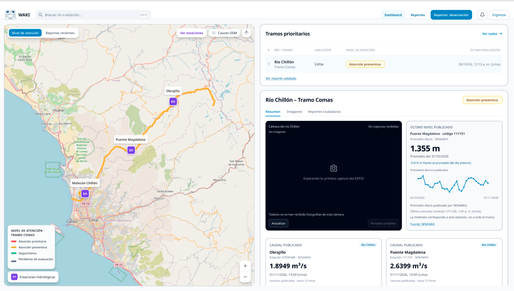
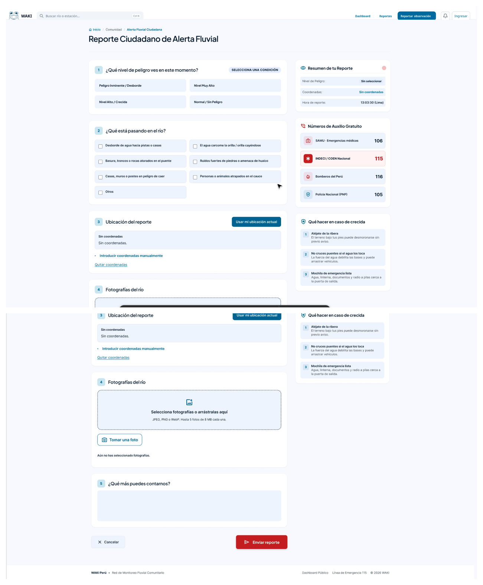
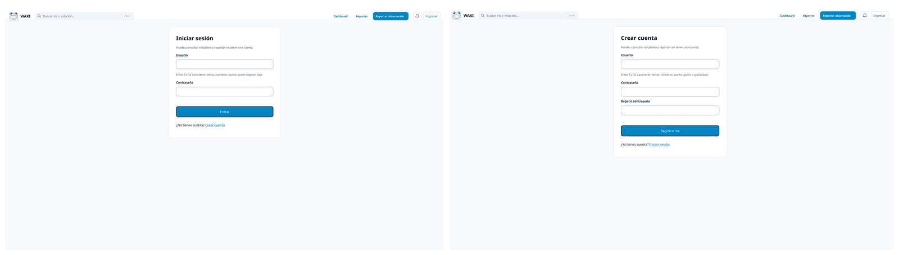
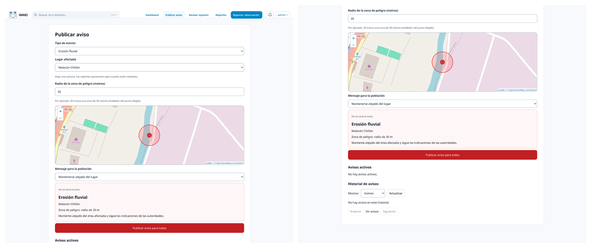
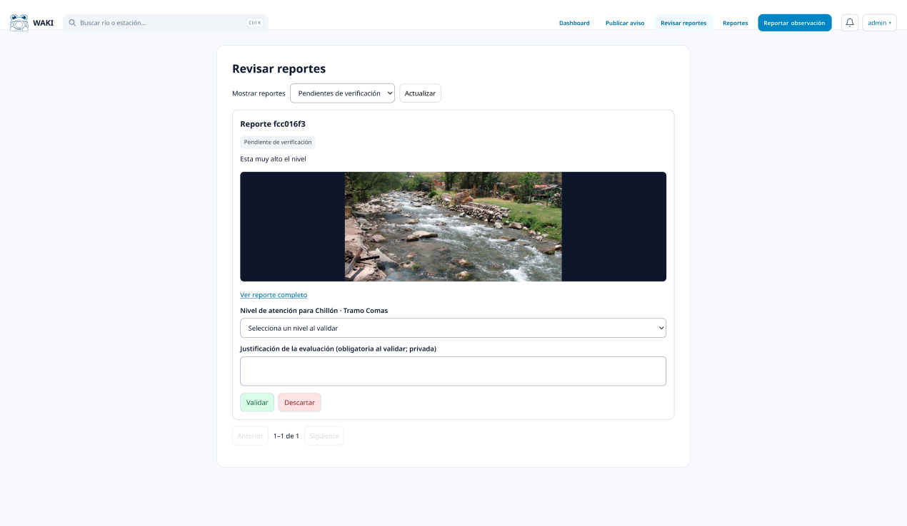
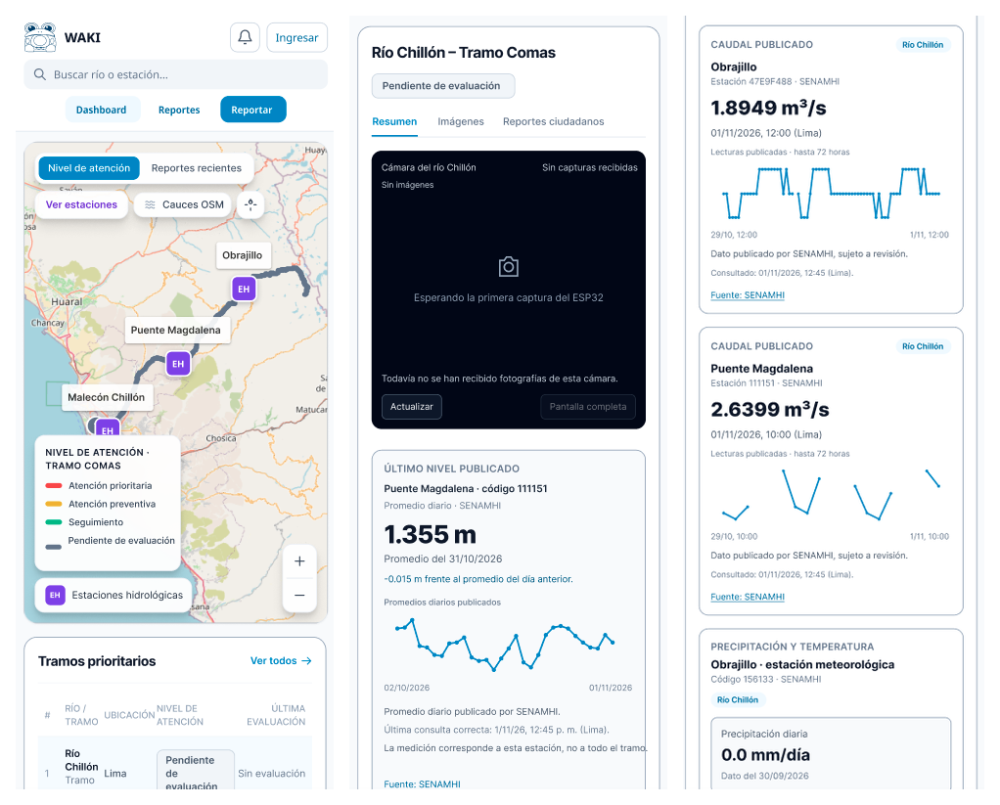
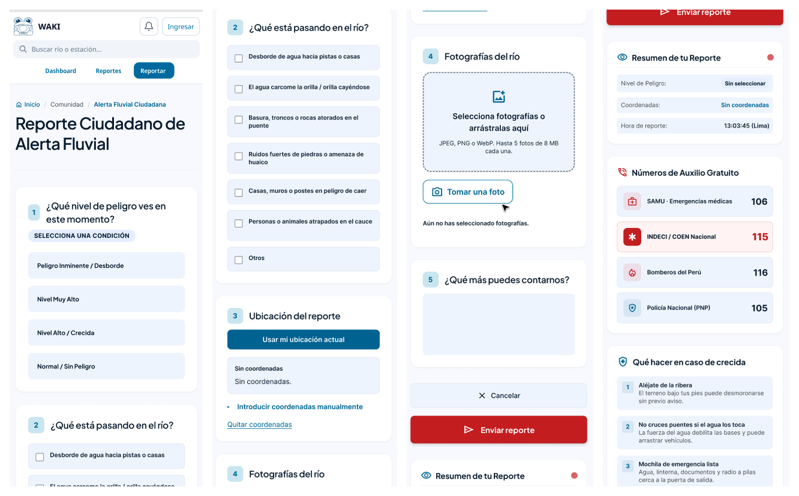
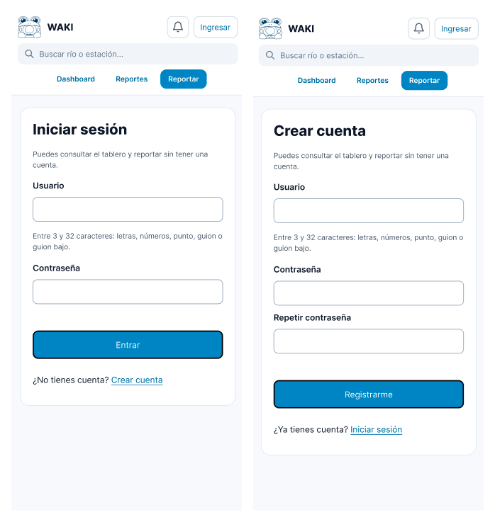
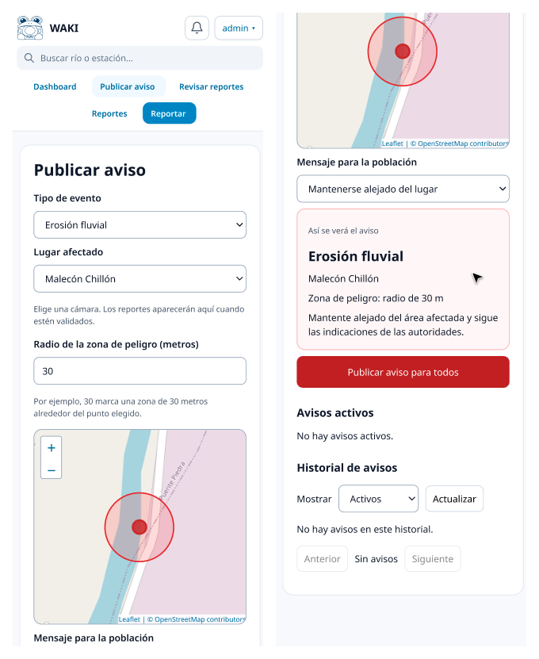
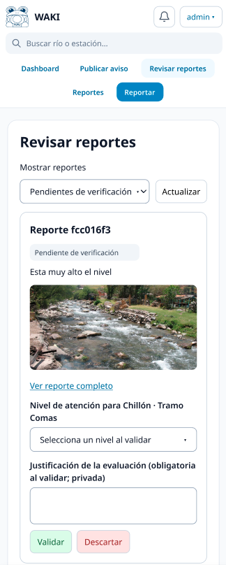

# 4. Prototipar: construir para aprender

[← Anterior](03-idear.md) | [Índice](README.md) | [Siguiente →](05-evaluar.md)

## Planificación del prototipo

| Campo | Detalle |
|---|---|
| Objetivos | 1. Permitir que el personal de la municipalidad (GRD) pueda identificar, verificar y priorizar los tramos ribereños que requieren atención técnica preventiva. 2. Involucrar al vecino como agente activo y visible de la acción preventiva de los desbordes mediante reportes simples que se integren en una plataforma municipal y le permitan seguir el estado de su aporte, visibilizándolo como parte integral de la prevención. |
| Audiencia (quién usará el prototipo) | Personal municipal de GRD/COE y vecinos del malecón Chillón–Gallinazos. |
| Técnica de prototipado | Storyboard. Prototipo funcional: sitio web con vista de reporte ciudadano y panel de administrador, y dispositivo ESP32-CAM integrado con el modelo de reconocimiento de imágenes. Carcasa diseñada en Onshape e impresa en 3D. |
| Nivel de fidelidad | Alto: un prototipo funcional que recauda información hidrológica del SENAMHI. Se usarían datos de prueba ingresados manualmente, obtenidos de la estación hidrológica de Obrajillo. |
| Dispositivos de uso | Celular (vecino) y computadora (personal municipal). |

## Escenarios clave

| ID | Escenario |
|---|---|
| E1 | Un vecino reporta acumulación de residuos con una foto. |
| E2 | La evidencia coincide (reporte + cámara + caudal) y el nivel del agua en dicho tramo aumenta. |
| E3 | Un reporte ciudadano no tiene respaldo y el personal municipal lo descarta. |
| No validado | Predicción de desbordes; confirmación automática de inundación por imagen. |

## Artefactos

La implementación no se duplica aquí; cada artefacto enlaza a su documentación o código.

| Artefacto | Descripción | Dónde está |
|---|---|---|
| Sitio web WAKI | Vista de reporte ciudadano y panel de administrador, accesible desde celular o PC. | Pantallas: [ANX-04 y ANX-05](#secuencia-de-pantallas) · Prototipos HTML: [`docs/prototypes/`](../prototypes/README.md) · Código: [`app/`](../../app/) |
| Dispositivo de monitoreo | ESP32-CAM con carcasa impresa en 3D. | Firmware: [`firmware/waki_esp32cam/`](../../firmware/waki_esp32cam/) · Documentación: [`docs/esp32-camera.md`](../esp32-camera.md) |
| Modelo de reconocimiento de imágenes | Integrado al dispositivo. | [`docs/ia/`](../ia/LEEME_INICIO.md) |
| Modelo CAD de la carcasa (Onshape) | Diseño de la carcasa para impresión 3D. | ANX-08 (pendiente, ver abajo) |
| Storyboard | Flujo vecino → plataforma → personal GRD. | ANX-07 (pendiente, ver abajo) |

### Imágenes pendientes

| ID | Contenido | Archivo esperado |
|---|---|---|
| ANX-07 | Storyboard del flujo vecino → plataforma → personal GRD | `anexos/img/prototipar/anx-07-storyboard.jpg` |
| ANX-08 | Modelo CAD de la carcasa (Onshape) | `anexos/img/prototipar/anx-08-carcasa-cad.png` |

> TODO: pendiente — agregar estas imágenes en [`anexos/img/prototipar/`](anexos/img/prototipar/) con los nombres indicados y referenciarlas aquí.

## Secuencia de pantallas

Capturas del prototipo funcional tomadas de los Anexos 4 y 5 de la Ficha Técnica. Las pantallas que en la Ficha estaban bajo un mismo rótulo se muestran juntas.

### ANX-04: Pantallas de la web (PC)

#### Dashboard

#### Reportes

#### Cuentas

#### Admin: envío de notificaciones

#### Admin: validar reportes

### ANX-05: Pantallas del aplicativo (celular)

#### Dashboard

#### Reportes

#### Cuenta

#### Admin: envío de notificaciones

#### Admin: validar reportes

