# 4. Prototipar: construir para aprender

[← Anterior](03-idear.md) | [Índice](README.md) | [Siguiente →](05-evaluar.md)

## Planificación del prototipo

| Campo | Detalle |
|---|---|
| Objetivos | 1. Permitir que el personal de la municipalidad (GRD) pueda identificar, verificar y priorizar los tramos ribereños que requieren atención técnica preventiva. 2. Involucrar al vecino como agente activo y visible de la acción preventiva de los desbordes mediante reportes simples que se integren en una plataforma municipal y le permitan seguir el estado de su aporte, visibilizándolo como parte integral de la prevención. |
| Audiencia (quién usará el prototipo) | Personal municipal de GRD/COE y vecinos del malecón Chillón–Gallinazos. |
| Técnica de prototipado | Storyboard. Prototipo funcional: sitio web con vista de reporte ciudadano y panel de administrador, y dispositivo ESP32-CAM integrado con el modelo de reconocimiento de imágenes. Carcasa diseñada en Onshape e impresa en 3D. |
| Nivel de fidelidad | Alto: un prototipo funcional que recauda información hidrológica del SENAMHI. Se usarían datos de prueba ingresados manualmente, obtenidos de la estación hidrológica de Obrajillo. |
| Dispositivos de uso | Celular (vecino) y computadora (personal municipal). |

## Escenarios clave

| ID | Escenario |
|---|---|
| E1 | Un vecino reporta acumulación de residuos con una foto. |
| E2 | La evidencia coincide (reporte + cámara + caudal) y el nivel del agua en dicho tramo aumenta. |
| E3 | Un reporte ciudadano no tiene respaldo y el personal municipal lo descarta. |
| No validado | Predicción de desbordes; confirmación automática de inundación por imagen. |

## Artefactos

La implementación no se duplica aquí; cada artefacto enlaza a su documentación o código.

| Artefacto | Descripción | Dónde está |
|---|---|---|
| Sitio web WAKI | Vista de reporte ciudadano y panel de administrador, accesible desde celular o PC. | Pantallas: [ANX-05 y ANX-06](#secuencia-de-pantallas) · Diseño en [Figma](https://www.figma.com/design/uz8ZkFeTMAT75fdedoP7RO/WAKI-%C2%B7-Prototipos-de-la-aplicaci%C3%B3n-actual?node-id=0-1) · Prototipos HTML: [`docs/prototypes/`](../prototypes/README.md) · Código: [`app/`](../../app/) |
| Dispositivo de monitoreo | ESP32-CAM con carcasa impresa en 3D. | Firmware: [`firmware/waki_esp32cam/`](../../firmware/waki_esp32cam/) · Documentación: [`docs/esp32-camera.md`](../esp32-camera.md) |
| Modelo de reconocimiento de imágenes | Integrado al dispositivo. | Resultados en plataforma: [ANX-04](#anx-04-visualización-de-resultados-del-análisis-de-visión-computacional) · [`docs/ia/`](../ia/LEEME_INICIO.md) |
| Arquitectura funcional | Flujo de integración de los componentes tecnológicos. | [ANX-07](#anx-07-arquitectura-funcional-de-waki) |
| Modelo CAD de la carcasa (Onshape) | Diseño de la carcasa para impresión 3D. Boceto inicial en [ANX-03](03-idear.md#anx-03-boceto-conceptual-inicial). | ANX-09 (pendiente, ver abajo) |
| Storyboard | Flujo vecino → plataforma → personal GRD. | ANX-08 (pendiente, ver abajo) |

### Imágenes pendientes

| ID | Contenido | Archivo esperado |
|---|---|---|
| ANX-08 | Storyboard del flujo vecino → plataforma → personal GRD | `anexos/img/prototipar/anx-08-storyboard.jpg` |
| ANX-09 | Modelo CAD de la carcasa (Onshape) | `anexos/img/prototipar/anx-09-carcasa-cad.png` |

> TODO: pendiente — agregar estas imágenes en [`anexos/img/prototipar/`](anexos/img/prototipar/) con los nombres indicados y referenciarlas aquí.

## ANX-07: Arquitectura funcional de WAKI

Diagrama de la arquitectura funcional de WAKI y el flujo de integración de sus componentes tecnológicos.

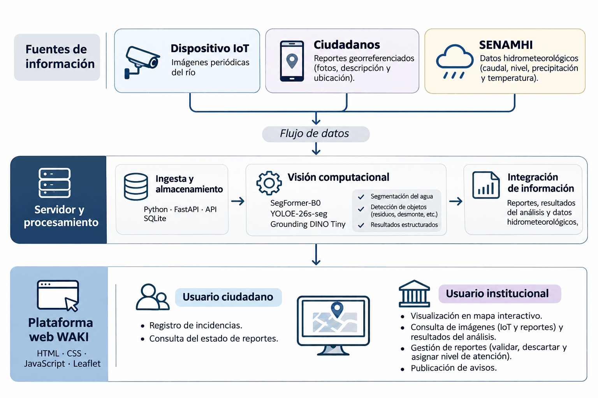

## Secuencia de pantallas

Capturas del prototipo funcional tomadas de los Anexos 4, 5 y 6 de la Ficha Técnica. Las pantallas que en la Ficha estaban bajo un mismo rótulo se muestran juntas. Diseño completo en [Figma](https://www.figma.com/design/uz8ZkFeTMAT75fdedoP7RO/WAKI-%C2%B7-Prototipos-de-la-aplicaci%C3%B3n-actual?node-id=0-1).

### ANX-04: Visualización de resultados del análisis de visión computacional

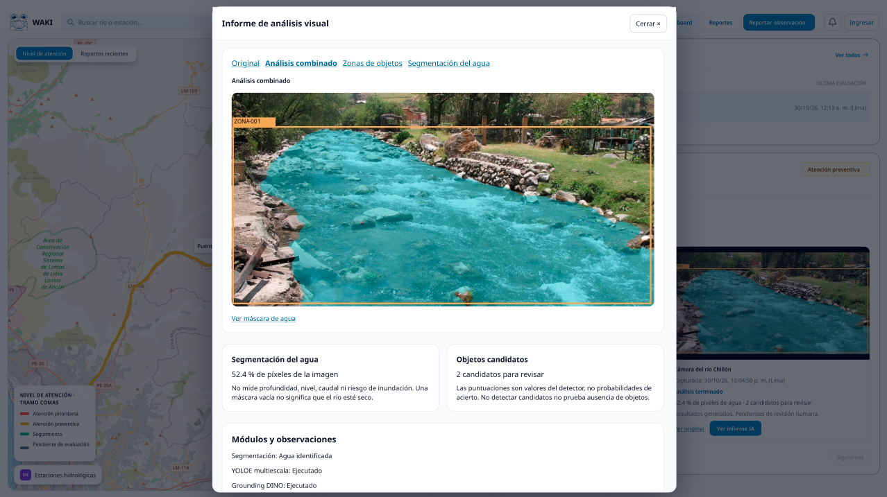

### ANX-05: Pantallas de la plataforma (PC)

#### a. Inicio de sesión del usuario

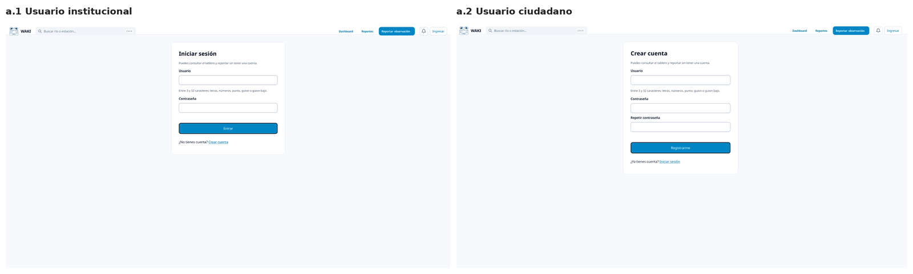

#### b. Visualización del dashboard (usuario institucional y usuario ciudadano)

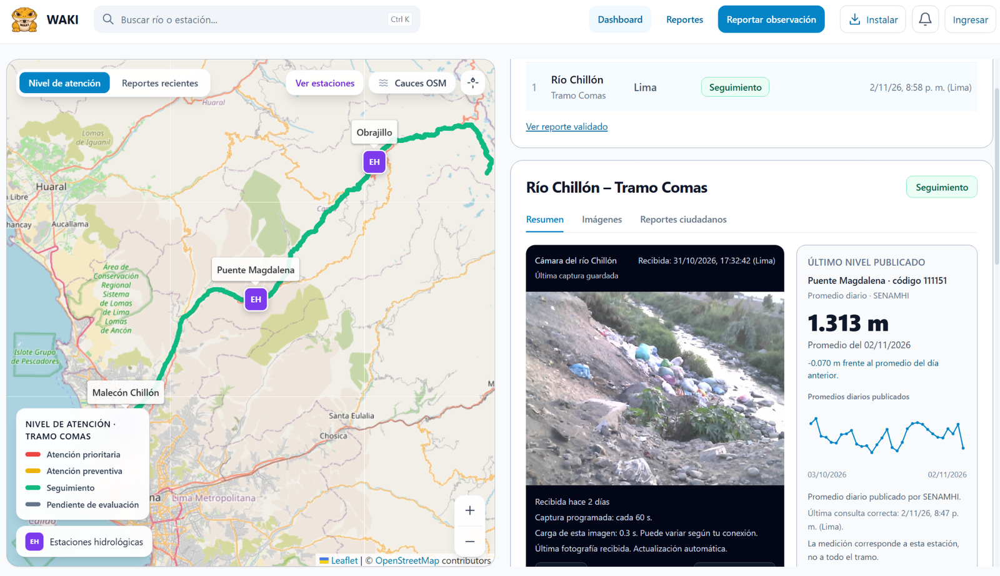

#### c. Visualización y registro de reportes (usuario ciudadano)

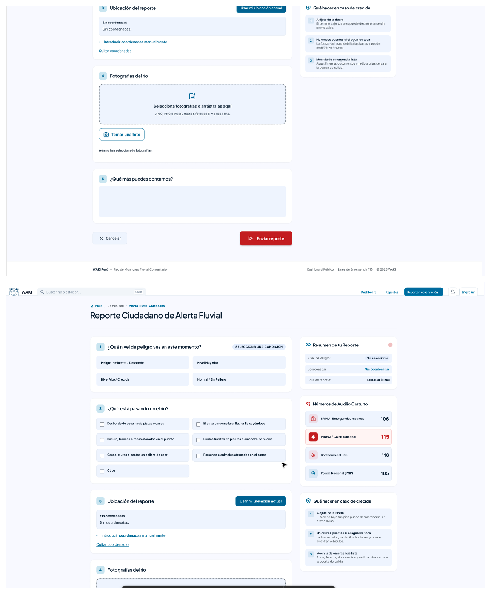

#### d. Gestión administrativa de incidencias y comunicación (usuario institucional)

##### d.1. Publicación y gestión de avisos

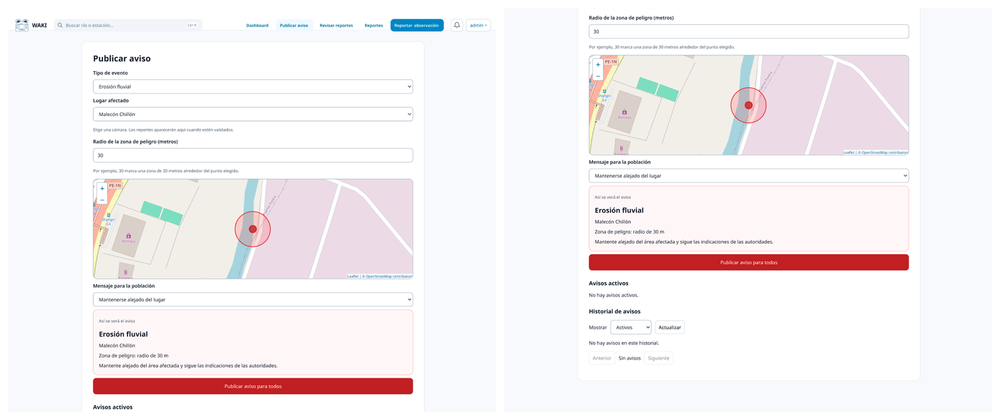

##### d.2. Validación y revisión de reportes ciudadanos

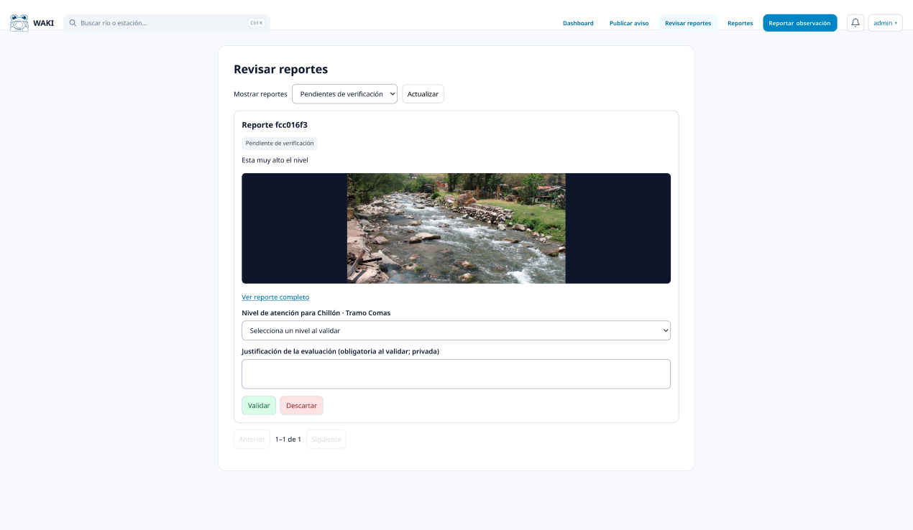

### ANX-06: Pantallas vía dispositivo móvil

#### Dashboard

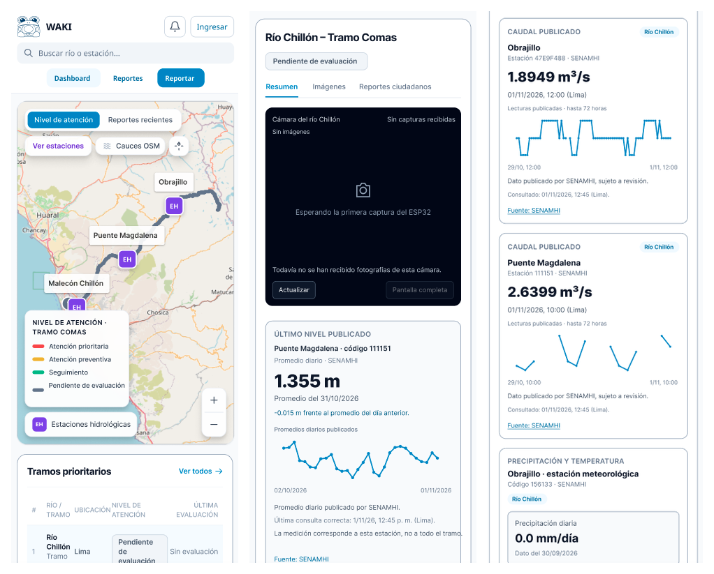

#### Reportes

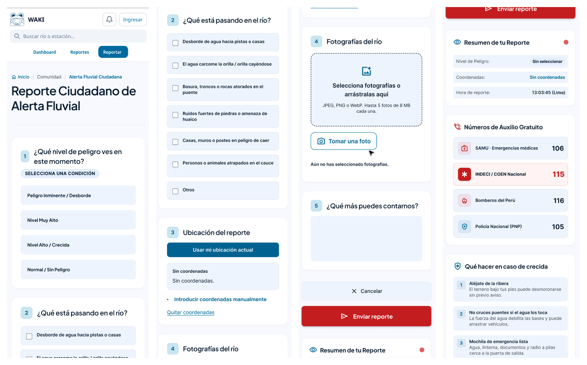

#### Inicio de sesión del usuario

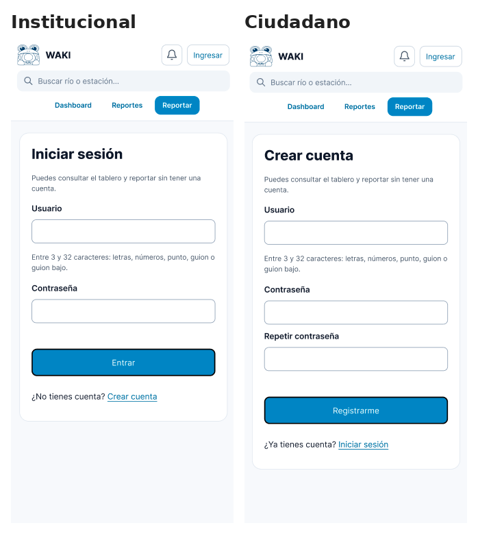

#### Gestión administrativa de incidencias y comunicación (usuario institucional)

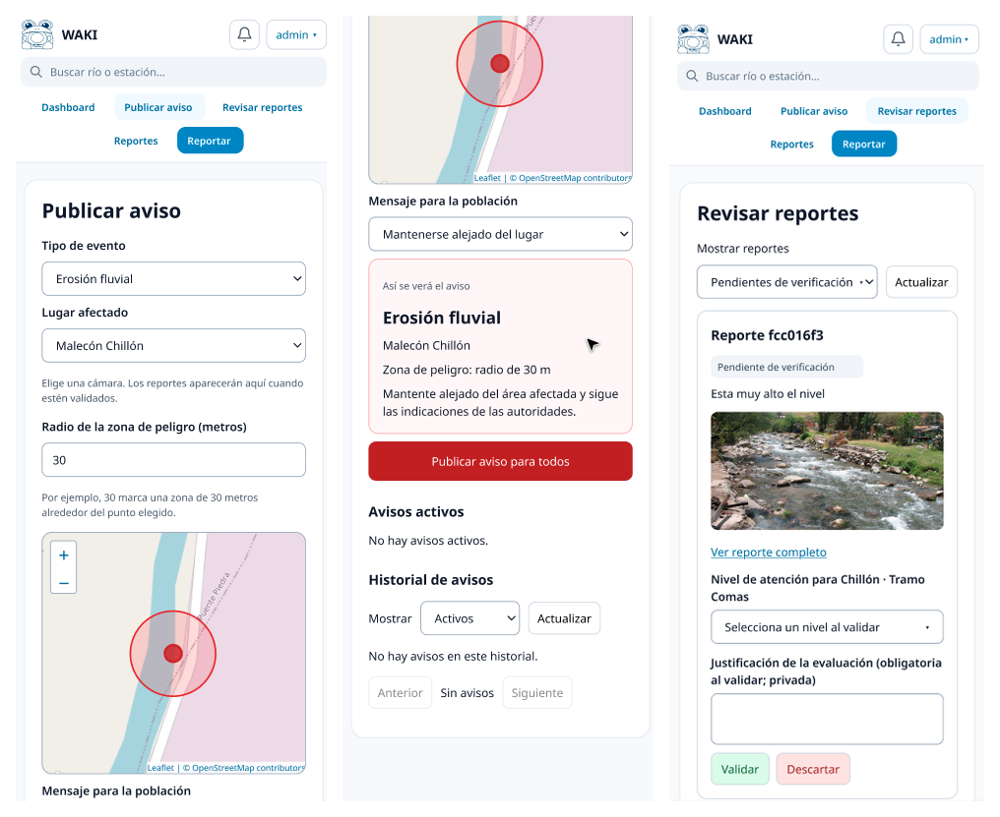
