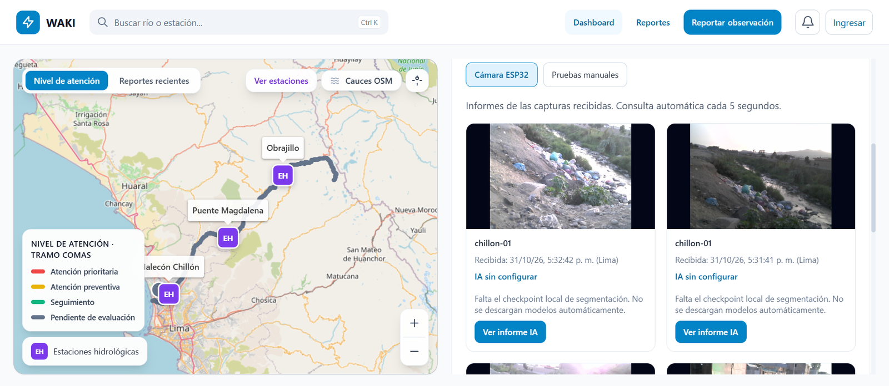
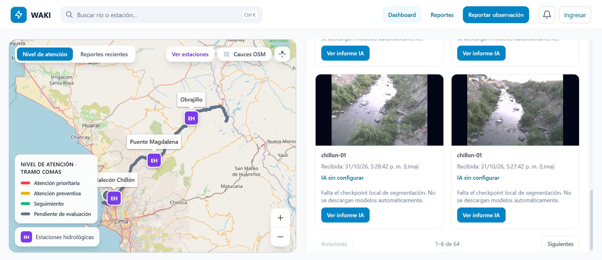
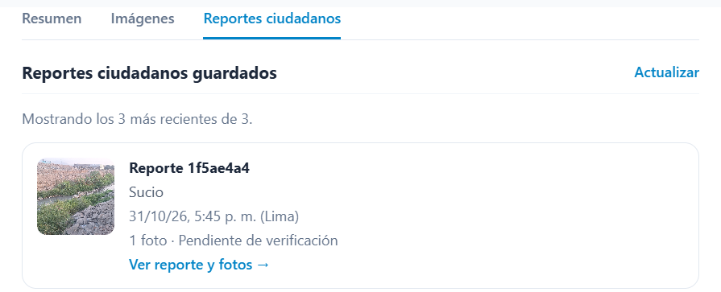
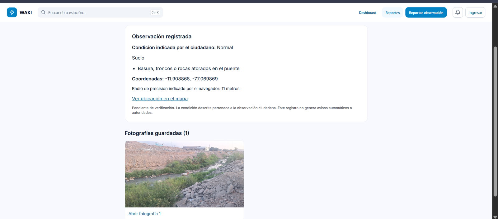
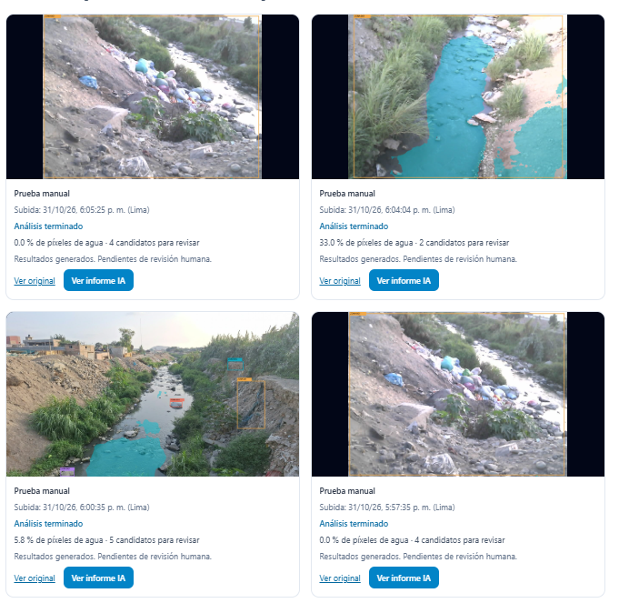

# 5. Evaluar: pruebas con tareas y evidencia

[← Anterior](04-prototipar.md) | [Índice](README.md) | [Siguiente →](evidencias.md)

> TODO: pendiente — esta fase aún no se ha realizado. Las secciones siguientes son la plantilla a completar.

## Planificación de la investigación evaluativa

| Campo | Registro |
|---|---|
| ¿Qué es lo que vas a evaluar? | TODO: pendiente |
| Muestra de investigación | TODO: pendiente |
| Objetivos | TODO: pendiente |
| Definición de tareas | TODO: pendiente |
| Hipótesis (alto, medio, bajo) | TODO: pendiente |
| Modalidad de evaluación y herramientas | TODO: pendiente |
| Cronograma de evaluación y duración de las sesiones | TODO: pendiente |

## Entrevistas

> TODO: pendiente

## Descarga de comentarios por objetivo y tarea

### Objetivo 1: Evaluar la experiencia inicial del usuario al interactuar con la plataforma

| | Tarea 1 | Tarea 2 | Tarea 3 |
|---|---|---|---|
| Pantallas de referencia | Pantalla 1 | Pantalla 2 | Pantalla 3 |
| Tareas / aciertos | TODO | TODO | TODO |
| Oportunidades de mejora | TODO | TODO | TODO |
| Nuevas ideas | TODO | TODO | TODO |
| Dudas | TODO | TODO | TODO |

### Objetivo 2

> TODO: pendiente — definir el objetivo.

| | Tarea 1 | Tarea 2 | Tarea 3 |
|---|---|---|---|
| Pantallas de referencia | Pantalla 1 | Pantalla 2 | Pantalla 3 |
| Tareas / aciertos | TODO | TODO | TODO |
| Oportunidades de mejora | TODO | TODO | TODO |
| Nuevas ideas | TODO | TODO | TODO |
| Dudas | TODO | TODO | TODO |

## Hallazgos y conclusiones por objetivo

| | Objetivo 1 | Objetivo 2 | Objetivo 3 |
|---|---|---|---|
| Hallazgos | TODO | TODO | TODO |
| Conclusiones | TODO | TODO | TODO |
| Sugerencias | TODO | TODO | TODO |

## Evidencia disponible: prueba en campo (31/10/2026)

La Ficha Técnica registra una prueba en campo el 31/10/2026, en la que se evaluó el funcionamiento del dispositivo bajo las condiciones reales (Tabla 3, columna "Ajuste" sin completar). Estas capturas, tomadas de la pestaña "Pruebas" de la Ficha, son la evidencia disponible de esa prueba. No sustituyen el plan ni los resultados de esta fase.

| ID | Contenido |
|---|---|
| PRU-01-C01 | Dashboard, pestaña de cámara ESP32 con capturas del 31/10 |
| PRU-01-C02 | Dashboard, capturas de la cámara ESP32 (continuación) |
| PRU-01-C03 | Reportes ciudadanos guardados: reporte del 31/10, pendiente de verificación |
| PRU-01-C04 | Observación ciudadana registrada con fotografía y coordenadas |
| PRU-01-C05 | Pruebas manuales del 31/10 con análisis de IA terminado, pendientes de revisión humana |

> TODO: pendiente — registrar qué se observó en la prueba, los problemas encontrados y el ajuste decidido.

Nuevas imágenes de esta fase van en [`anexos/img/evaluar/`](anexos/img/evaluar/) y se registran en el [índice de anexos](anexos/README.md).
