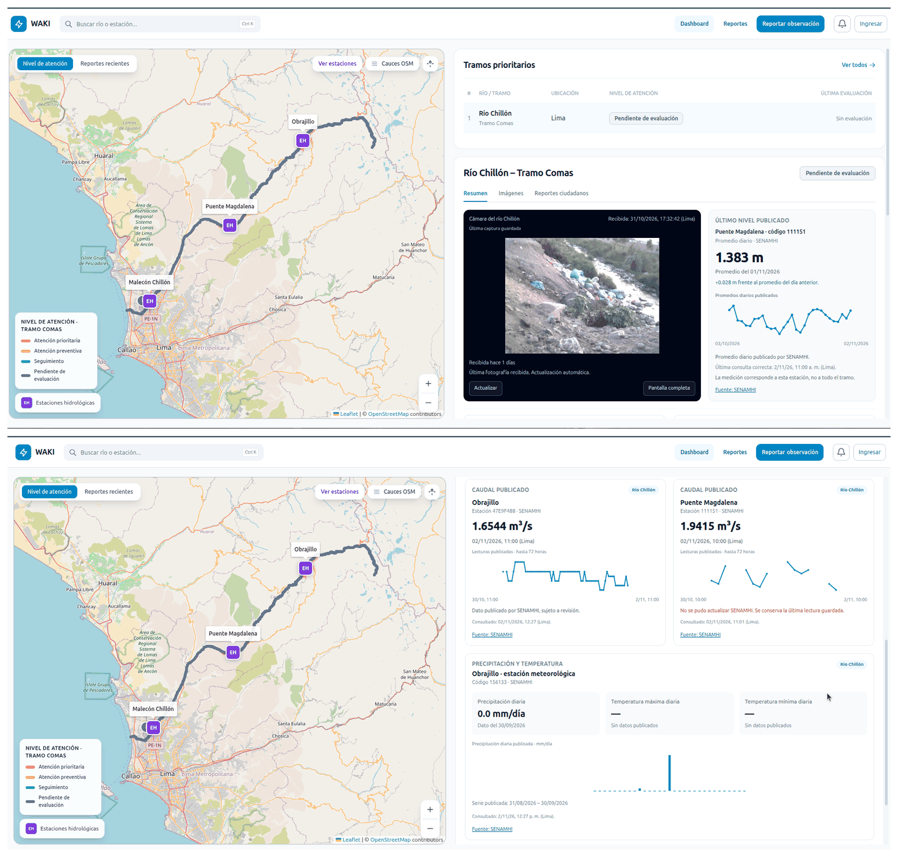
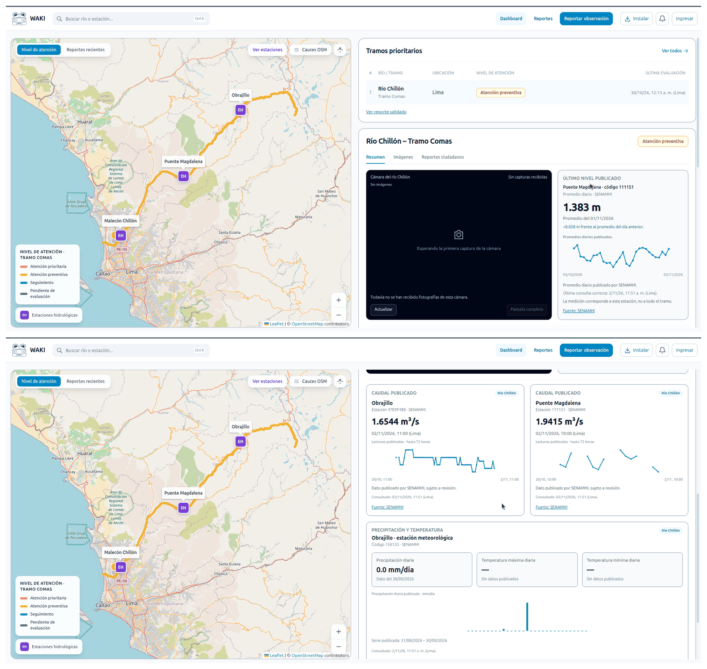
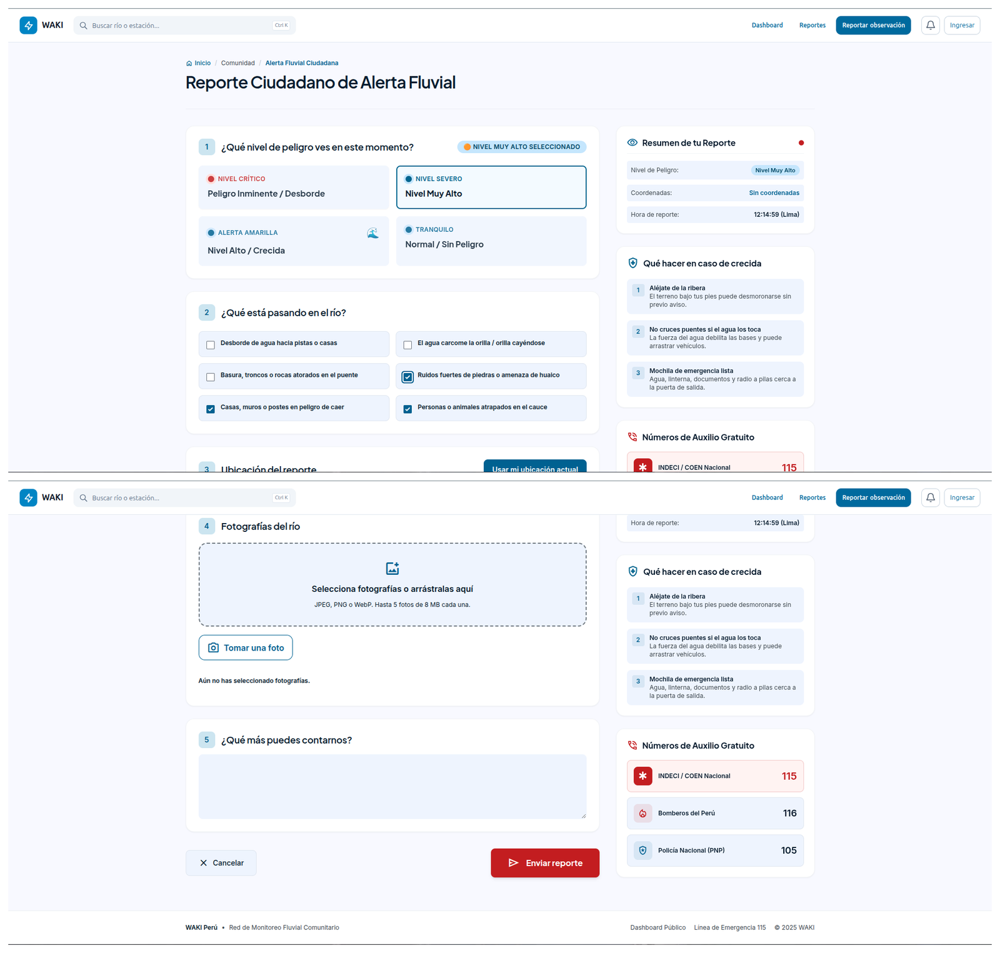
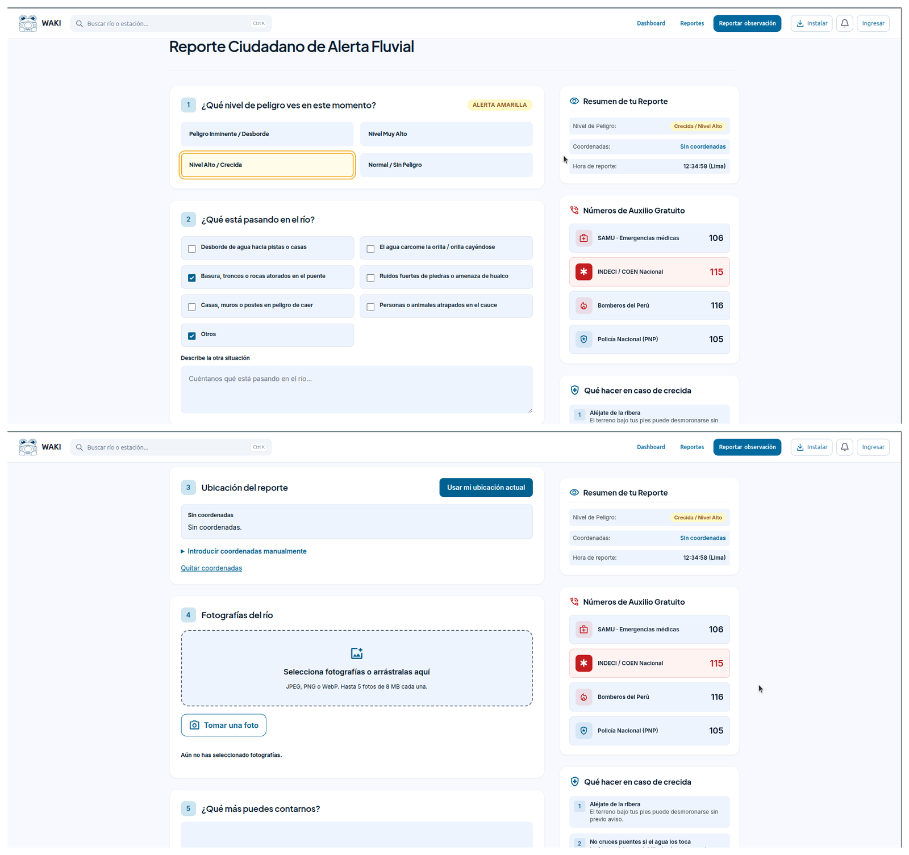
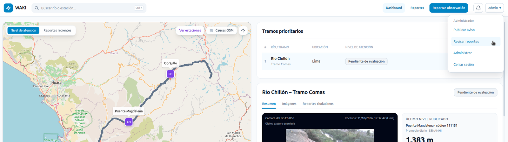
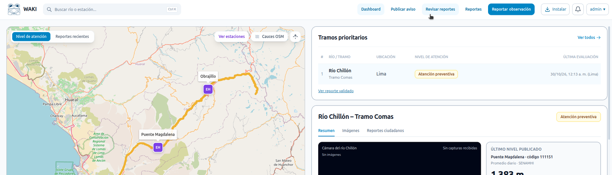
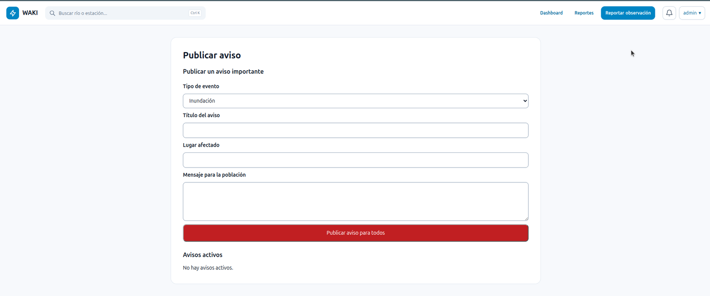
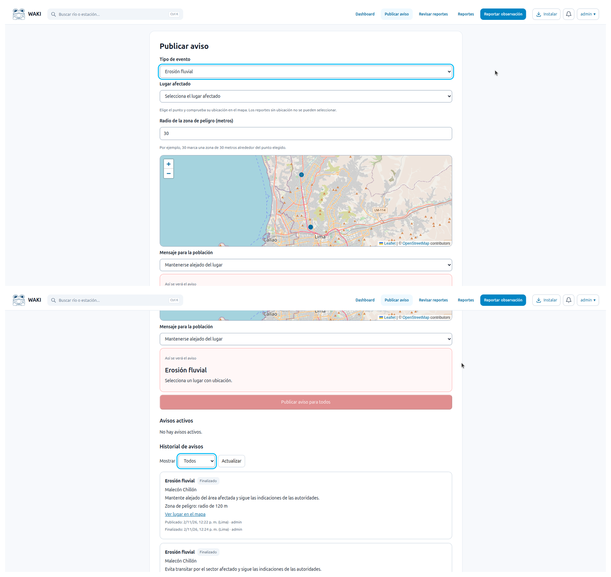

# 5. Evaluar: pruebas con tareas y evidencia

[← Anterior](04-prototipar.md) | [Índice](README.md) | [Siguiente →](evidencias.md)

## Planificación de la investigación evaluativa

| **¿Qué es lo que vas a evaluar?** | La experiencia de uso de la plataforma WAKI desde la perspectiva del usuario ciudadano e institucional, así como la visualización de la información generada por el dispositivo IoT. |
|---|---|
| **Muestra investigación** | Ciudadanos y profesionales o representantes con funciones vinculadas a la gestión del riesgo de desastres a nivel municipal. |
| **Objetivo 1** | Evaluar la experiencia inicial del usuario ciudadano al interactuar con la plataforma. |
| **Hipótesis 1 (confianza inicial: media)** | El ciudadano puede registrar una incidencia, adjuntar una fotografía y proporcionar su ubicación de manera sencilla, sin asistencia externa. |
| **Objetivo 2** | Evaluar la consulta y gestión de información por parte del usuario institucional en la plataforma. |
| **Hipótesis 2 (confianza inicial: media)** | El usuario institucional puede consultar los reportes ciudadanos, visualizar las imágenes del dispositivo IoT y los datos hidrometeorológicos, y gestionar las incidencias desde el dashboard. |
| **Modalidad evaluación y herramientas** | Pruebas de usabilidad mediante tareas guiadas, observación directa, entrevistas breves y registro de evidencias. Se utilizarán dispositivos móviles y computadoras para la interacción con la plataforma. |
| **Cronograma de evaluación y duración de las sesiones** | Sesiones individuales de aproximadamente 15 a 20 minutos por participante, durante la etapa de validación del MVP. |

## Evaluación por objetivos y tareas

| **Objetivo 1:**  | Evaluar la experiencia inicial del usuario ciudadano al interactuar con la plataforma. |
|---|---|
| **Tarea 1** | Ingresar a la plataforma desde un dispositivo móvil y ubicar el formulario de registro de incidencias. |
| **Tarea 2** | Completar el formulario, indicando el tipo y condición de la incidencia y añadir una breve descripción. |
| **Tarea 3** | Adjuntar una fotografía, proporcionar la ubicación y enviar el reporte. |
| **Pantallas de referencia** | Pantalla 1: Foto de pantalla de inicio. |
| | Pantalla 2: Sección de formulario de registro (incluye fotografía a adjuntar e ingreso de ubicación). |
| | Pantalla 3: Confirmación del envío del reporte. |
| Aspectos que se registrarán durante la evaluación: | |
| **Aciertos** | Tareas completadas correctamente, facilidad de navegación en la plataforma y comprensión del formulario por parte del usuario ciudadano. |
| **Oportunidades de Mejora** | Dificultades para completar campos, adjuntar fotografías o proporcionar la ubicación. |
| **Nuevas Ideas** | Funcionalidades o mejoras propuestas por los participantes. |
| **Dudas** | Preguntas o confusiones durante el uso de la plataforma. |

| **Objetivo 2:**  | Evaluar la consulta y gestión de información por parte del usuario institucional en la plataforma. |
|---|---|
| **Tarea 1** | Ingresar al dashboard y localizar los reportes ciudadanos en el mapa. |
| **Tarea 2** | Consultar las imágenes captadas por el dispositivo IoT, resultados del análisis de visión computacional y datos hidrometeorológicos disponibles. |
| **Tarea 3** | Revisar un reporte ciudadano, validarlo o descartarlo, y asignarle un nivel cualitativo de atención. |
| **Pantallas de referencia** | Pantalla 1: Dashboard de monitoreo. |
| | Pantalla 2: Visualización de imágenes y resultados del análisis. |
| | Pantalla 3: Gestión de reportes ciudadanos. |
| Aspectos que se registrarán durante la evaluación: | |
| **Aciertos** | Facilidad para localizar información, interpretar las evidencias y gestionar reportes ciudadanos. |
| **Oportunidades de Mejora** | Dificultades de navegación, comprensión de los datos o ejecución de funciones administrativas. |
| **Nuevas Ideas** | Mejoras propuestas para la consulta y gestión de información. |
| **Dudas** | Consultas sobre el funcionamiento de las herramientas y la interpretación de los datos. |

## Descripción de hallazgos y conclusiones por objetivo

| | **Objetivo 1: Ciudadano** | **Objetivo 2: Institucional** |
|---|---|---|
| **Hallazgos** | El entrevistado confía en los datos por provenir del SENAMHI y valora los reportes ciudadanos y las notificaciones a personas cercanas al peligro. Sin embargo, plantea dudas sobre la veracidad de los reportes y los tiempos de captura y carga de las imágenes. | El entrevistado está conforme con el dashboard, pero considera útiles los umbrales por información, los últimos datos en los puntos del mapa y las tablas históricas. En los reportes, solicita opciones más claras, diferenciar emergencias de personas y animales, centrándose más en la persona, y facilitar el contacto con quien reporta. También valora los avisos con ubicación, zonas de peligro y recomendaciones. |
| **Conclusiones** | La información oficial y la participación ciudadana se perciben como útiles para advertir a las comunidades. La verificación de los reportes y la claridad sobre la actualización de las imágenes contribuyen a generar confianza. | Las mejoras propuestas buscan facilitar la interpretación de los datos y orientar a la población ante una emergencia. La validación administrativa y el contacto con el reportante se consideran importantes para generar confianza en los reportes publicados. |
| **Sugerencias** | Validar los reportes antes de mostrarlos a la comunidad e indicar su estado de verificación. También, informar cada cuánto se capturan las imágenes y cuánto tardan en cargarse. | Añadir umbrales por tarjeta de información, datos recientes en los puntos del mapa y acceso al historial en tablas. Resaltar la severidad de las opciones, incluir “Otros” como opción, separar personas y animales, agregar SAMU y colocar primero a Bomberos en la vista de opción adicional. Incorporar indicaciones para niveles naranja o superiores y avisos con selección en mapa, radio de peligro y recomendaciones.  Solicitar un teléfono asociado a las cuentas y opcional para reportes sin cuenta, mostrando al público únicamente los reportes validados. El entrevistado también propone dar menor credibilidad a los reportes sin contacto y considerar incentivos por aportes confiables. |

## Iteración: pantallas antes y después de la evaluación

Capturas de la plataforma antes y después de los ajustes, registradas por el equipo en la Ficha Técnica. Las sugerencias que motivaron los cambios están en la tabla de [hallazgos y conclusiones](#descripción-de-hallazgos-y-conclusiones-por-objetivo).

| Vista | Antes | Después |
|---|---|---|
| ITE-01 · Dashboard |  |  |
| ITE-02 · Reportes |  |  |
| ITE-03 · Opciones de administrador |  |  |
| ITE-04 · Alerta |  |  |

> TODO: pendiente — describir qué cambió en cada vista y qué sugerencia lo motivó.

## Evidencia disponible: prueba en campo (2026-10-31)

La Ficha Técnica registra una prueba en campo el 2026-10-31, en la que se evaluó el funcionamiento del dispositivo bajo las condiciones reales (Tabla 3, columna "Ajuste" sin completar). Estas capturas, tomadas de la pestaña "Pruebas" de la Ficha, son la evidencia disponible de esa prueba. No sustituyen el plan ni los resultados de esta fase.

| ID | Contenido |
|---|---|
| PRU-01-C01 | Dashboard, pestaña de cámara ESP32 con capturas del 2026-10-31 |
| PRU-01-C02 | Dashboard, capturas de la cámara ESP32 (continuación) |
| PRU-01-C03 | Reportes ciudadanos guardados: reporte del 2026-10-31, pendiente de verificación |
| PRU-01-C04 | Observación ciudadana registrada con fotografía y coordenadas |
| PRU-01-C05 | Pruebas manuales del 2026-10-31 con análisis de IA terminado, pendientes de revisión humana |

> TODO: pendiente — registrar qué se observó en la prueba, los problemas encontrados y el ajuste decidido.

Nuevas imágenes de esta fase van en [`anexos/img/evaluar/`](anexos/img/evaluar/) y se registran en el [índice de anexos](anexos/README.md).
